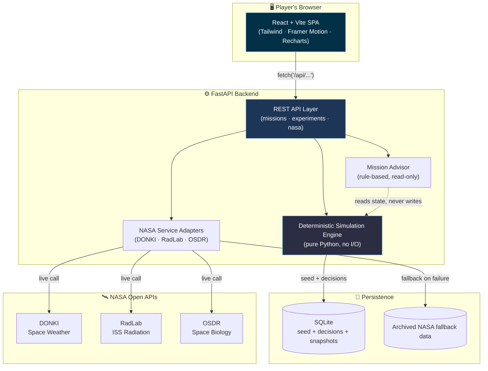

<div align="center">

# 🚀 ASTRA — Junior Astronaut Mission Trainer

### *Your mission. Your decisions. Their survival.*


**A consequence-driven lunar outpost simulator for children aged 7–12**

*Built by Team **Orbitelle** for the NASA Space Apps Challenge 2026*

[Live Demo](#-live-demo) · [Features](#-features) · [Architecture](#-architecture) · [Run Locally](#-run-it-yourself) · [NASA Data](#-nasa-data-sources)

</div>

---

## 🌍 Problem Statement

Space-themed STEM content for kids usually does one of two things: it oversimplifies
the real engineering trade-offs of a space mission into a quiz, or it buries them in
technical detail written for adults. Real astronauts on a lunar outpost have to
constantly balance **limited power, oxygen, water, food, radiation protection and a
fragile link to Earth** — and there is rarely a single right answer, only choices with
costs.

**ASTRA** is our answer: a playable simulation, grounded in genuine NASA open data,
that teaches those trade-offs by making a child live through them — not by telling
them about it.

## 🛰️ Live Demo

| | |
|---|---|
| **Play it live** | *(link added after deployment — see [Run It Yourself](#-run-it-yourself) in the meantime)* |
| **Source code** | [github.com/Anannyaa97/ASTRA](https://github.com/Anannyaa97/ASTRA) |
| **Team page** | [Orbitelle on Space Apps](https://www.spaceappschallenge.org/2026/find-a-team/orbitelle/) |

## 🎮 Features

- **Mission Simulator** — a habitat view, daily events with real trade-offs, a
  predictive preview of each option's effects *before* you commit, and a daily
  report explaining what changed and why.
- **Mission Ladder** — four ordered missions, each unlocked by finishing the one
  before it: **First Landing → Storm Season → The Long Night → Commander.**
- **Communication Delay** — the link to Earth is a real piece of equipment. Below
  70% it's weak; below 25% it's a full blackout and the Mission Advisor goes
  silent — reflecting the real light-time delay and line-of-sight challenges at
  the lunar South Pole.
- **What If? Lab** — change a parameter and run it against an isolated copy of the
  simulation, with before/after charts. Never touches your real mission.
- **Mission Advisor** — four rule-based expert voices that read the real simulation
  numbers and explain consequences. They never change mission state.
- **NASA Reality Hub** — live space weather (DONKI), real ISS radiation history
  (RadLab), lunar South Pole environment data, and curated space biology research
  (OSDR) — each one clearly labelled **LIVE**, **CACHED**, **ARCHIVED**, or
  **SIMULATED**.
- **Mission Investigation Report** — a failure is explained, not just displayed:
  primary cause, contributing decisions, resource history, how it could have been
  avoided.
- **Astronaut Academy** — child-friendly lessons connecting every game mechanic to
  the real science behind it.
- **Achievement badges** — computed from real mission history, never randomly
  awarded.

## 🏗️ Architecture

ASTRA is a **modular monolith**: a React single-page app talks to a FastAPI backend
over a small REST API. The backend's deterministic simulation engine is the *only*
authority on game state — the frontend never calculates a resource value itself, it
only displays what the backend computes. This is what makes a mission fully
**replayable**: the same seed and the same decisions always produce the same result.



**Why replay-from-seed instead of storing resource values directly?** The database
only stores a mission's random seed and the list of decisions made. To reconstruct
the current state, the backend *replays* every decision through the deterministic
engine from day one. That means the simulation engine is the single source of truth,
the frontend can never drift out of sync with it, and a finished mission can be
replayed exactly to investigate what went wrong — which is what powers the Mission
Investigation Report.

## 🧰 Tech Stack

| Layer | Technology |
|---|---|
| Frontend | React 18, Vite, Tailwind CSS, Framer Motion, Recharts, Lucide Icons |
| Backend | FastAPI, Pydantic v2, SQLAlchemy 2, SQLite |
| Testing | pytest — 166 backend tests |
| NASA Data | DONKI, RadLab (OSDR), OSDR, NASA Image & Video Library |

## 📂 Project Structure

```
astra/
├── frontend/
│   └── src/
│       ├── pages/        One file per screen (Mission Home, Simulator, NASA Hub, …)
│       ├── components/   Reusable UI pieces, grouped by area
│       ├── game/         The full-screen playable mission (/play)
│       ├── context/      MissionContext — the only place that talks to the backend
│       ├── utils/        Small pure helpers (formatting, the mission ladder, …)
│       └── data/         Static content: Academy lessons, dataset descriptions
└── backend/
    └── app/
        ├── api/          FastAPI routes
        ├── services/     The simulation engine and everything else that matters
        ├── data/         Event library and archived NASA fallback data
        ├── models/       SQLAlchemy tables
        └── schemas/      Pydantic request/response models
    └── tests/            166 tests
```

## 🔌 API Overview

| Endpoint | Purpose |
|---|---|
| `POST /api/missions/start` | Start a new mission on a chosen ladder rung |
| `GET /api/missions/{id}` | Full current mission state (replayed from seed) |
| `POST /api/missions/{id}/decision` | Submit a player's choice for today's event |
| `POST /api/missions/{id}/preview` | Predict an option's effect without applying it |
| `POST /api/missions/{id}/advance-day` | Run the daily simulation step |
| `GET /api/missions/{id}/report` | Final or in-progress mission report |
| `GET /api/missions/{id}/advice` | Mission Advisor's current read of the simulation |
| `GET /api/nasa/space-weather` | Live DONKI solar events |
| `GET /api/nasa/radiation` | Real ISS radiation-dose history |
| `POST /api/experiments/run` | Isolated What If? Lab experiment |

Full interactive docs are available at `/docs` once the backend is running.

## 🧪 Run It Yourself

### Requirements
- Python 3.10+
- Node.js 18+ and npm

### Backend
```bash
cd backend
python -m venv .venv
.venv\Scripts\activate        # macOS/Linux: source .venv/bin/activate
pip install -r requirements.txt
copy .env.example .env         # macOS/Linux: cp .env.example .env
python -m uvicorn app.main:app --reload --port 8000
```
Check: open http://localhost:8000/api/health

### Frontend
```bash
cd frontend
npm install
npm run dev
```
Open http://localhost:5173

### Tests
```bash
cd backend
.venv\Scripts\activate
python -m pytest -q
```

## 🛰️ NASA Data Sources

| Source | Used for | Fallback if offline |
|---|---|---|
| [DONKI](https://ccmc.gsfc.nasa.gov/DONKI/) | Space weather events (CME, FLR, SEP) | Archived snapshot |
| [RadLab](https://radlab.nasa.gov/) | Real ISS radiation-dose history | Archived snapshot |
| [OSDR](https://osdr.nasa.gov/) | Space biology research cards | Curated archive |
| [NASA Image and Video Library](https://images.nasa.gov/) | Imagery, with attribution | — |

If a live call fails, ASTRA falls back to a curated archived snapshot rather than
showing nothing or inventing data — and always labels which one you're looking at.

## 🎯 Design Principles

1. **The simulation engine is the only authority on resource values** — the
   frontend never computes game state, only displays it.
2. **Real NASA data and fictional training scenarios are never conflated.** A DONKI
   solar storm classification is never presented as an actual astronaut radiation
   dose.
3. **Every mission is deterministic and replayable** — the same seed and decisions
   always produce the same result.
4. **A failed mission is explained, not just scored.**

## ⚠️ Known Limitations

- All game values are normalized educational units, not real NASA engineering
  measurements.
- Live NASA calls depend on NASA's own API availability; ASTRA degrades to cached
  or archived data rather than failing silently.
- The "Real Sun check" linking live solar activity to the training storm's strength
  is a simplified game rule for teaching purposes, not a scientific radiation-dose
  calculation.

## 👥 Team Orbitelle

| | |
|---|---|
| **Anannya A K** | Designer & Developer · [GitHub](https://github.com/Anannyaa97) |
| **Saaniga Santosh** | Researcher |

## 🎵 Audio Attribution

Ambient track: ["Breathing Space Sparse Ambient Drone" by Alex Morgan](https://freemusicarchive.org/music/alex-morgan/ambient-relaxation-vol-1/breathing-space-sparse-ambient-drone/), licensed under [CC BY 4.0](https://creativecommons.org/licenses/by/4.0/). Re-encoded in mono at 22.05 kHz / 32 kbps.

## 📄 License

MIT — see [LICENSE](LICENSE). Copyright (c) 2026 Team Orbitelle.

---

<div align="center">

*"Space exploration is not just about reaching another world. It is about understanding how to survive there."*

</div>
